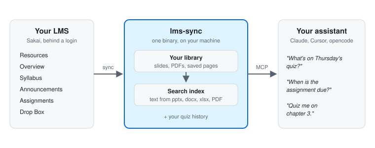

# lms-sync

[](https://github.com/sak0x7d5/lms-sync/actions/workflows/ci.yml)
[](https://go.dev)
[](LICENSE)

**Ask AI about your lectures. It answers from your own course files.**

lms-sync copies everything your university LMS holds for you (slides, outlines,
announcements and assignment briefs) to a folder on your machine. It makes all
of it searchable and hands it to Claude or any other MCP assistant, so you can
ask questions about it.

One file, no runtime and no dependencies. Runs on Windows, macOS, Linux and
Android.

<!-- hero GIF: docs/media/hero.gif, made with demo-video/compose.sh -->
<!-- demo video: drag demo.mp4 into the GitHub editor here; the URL must sit on a line of its own -->

## The problem

Course material is spread over six tabs of a website. Each one sits behind a
login, and half of it isn't a file at all: due dates live in Assignments, quiz
topics live in Announcements, and reading lists live on a course's Overview
page. To ask a chatbot about your own course you have to find, download and
upload each piece yourself, every time. It takes minutes, and the parts that
aren't files never get uploaded at all.

## What you can ask

> **What have we covered so far in Statistics, up to measures of central tendency?**

It answers from the course outline and three lecture PDFs and names each file.
It also notes that the outline lists the mode in week 3 but the uploaded notes
stop at the median.

> **When is my Statistics assignment due, and what's on it?**

The due date comes from the Assignments tab, in your own time zone. That's a
web page, not a file, so you'd never think to upload it.

> **I have a programming quiz this week. What's it on, and what array mistakes did my lecturer warn us about?**

This answer combines an announcement with slide 11 of a PowerPoint deck.

Then: **"Quiz me on it."** Questions come from your own slides. Your answers
are recorded and come back on a spaced-repetition schedule, so practice goes to
what you keep getting wrong.

## How it works

<p align="center">
  <picture>
    <source media="(prefers-color-scheme: dark)" srcset="docs/media/how-it-works-dark.svg">
    
  </picture>
</p>

1. **Sync.** It signs in to your LMS, finds your courses, and downloads only
   what is new or changed from each tab. Run it by hand or on a schedule.
2. **Extract.** PowerPoint, Word, Excel and PDF are each reduced once to
   plain text, so the whole library can be searched. A plain `grep` can't see
   inside a `.pptx`.
3. **Ask.** `lms-sync --mcp` serves the library to your assistant. Answers
   come from the copy on your disk in milliseconds, and cite the file they
   came from.

## Quickstart

**macOS, Linux, Android (Termux)**

```bash
curl -fsSL https://github.com/sak0x7d5/lms-sync/releases/latest/download/install.sh | sh
```

**Windows** (in PowerShell)

```powershell
irm https://github.com/sak0x7d5/lms-sync/releases/latest/download/install.ps1 | iex
```

Run `lms-sync`. A page opens in your browser. Enter your LMS address,
username, password and a folder, then press **Find my courses** and **Sync**.

Then point your assistant at it. For Claude Desktop, add this to
`claude_desktop_config.json`:

```json
{
  "mcpServers": {
    "lms": {
      "command": "/full/path/to/lms-sync",
      "args": ["--mcp"]
    }
  }
}
```

For Claude Code, Cursor and opencode, see [docs/assistants.md](docs/assistants.md).
For the installer's options and manual downloads, see [docs/install.md](docs/install.md).

## Features

- **Six tabs, not just Resources:** Overview, Syllabus, Announcements,
  Assignments and Drop Box too. Pages that hold text and no files are saved as
  pages, and links to material off the LMS are kept in a `Links.md`.
- **Search inside documents:** pptx, docx, xlsx, PDF, and the saved pages.
- **Study workflows for your assistant:** `prep_for_class`, `quiz_me`,
  `explain_from_my_material`, `catch_up` and `study_plan`.
- **Spaced repetition:** quiz answers are recorded, missed questions come back
  tomorrow, and `weak_spots` ranks topics by how often you miss them.
- **Fetch on request:** "anything new in Statistics?" makes the assistant sync
  just that course and list what changed.
- **Stays current:** a scheduled `--sync` checks for new material, and the
  installer updates the binary daily against the release's checksums.
- **Works on your phone:** the same binary runs under Termux on Android.
- **Optional Google Drive backup:** a one-way copy that includes your quiz
  history.
- **An `index.html` of everything you have**, newest first, with a filter box.

## Built to be trusted

It holds your university password and talks to a server that can lock your
account, so some things are rules, each one backed by a test:

- **No dependencies.** The Go standard library only, so `go.mod` has
  nothing to fetch, vendor or audit.
- **It never opens a quiz.** On some Sakai versions, simply loading a Tests &
  Quizzes link starts a timed attempt, so that tool is refused before any of
  its URLs are known.
- **It never retries a wrong password.** Retrying is how accounts get locked.
  A failed sign-in also returns HTTP 200 with the login form, so the session
  is checked rather than the status code being trusted.
- **It only reads.** There is no upload or delete path, and it only follows
  links on the LMS's own content paths.
- **Your password stays where you put it.** A password from `LMS_PASS` is
  never written to the config file, and the local interface is bound to
  `127.0.0.1` with a random token.
- **Nothing half-written.** Downloads, settings and the download record are
  all written to a temporary file and then renamed, so a crash can't leave a
  corrupt or truncated file behind.
- **166 tests** against a fake Sakai server that reproduces the real quirks.
  The fake records every request, so the tests can check what was *not*
  fetched.

[How it works, in detail](docs/how-it-works.md)

## Will this work at my university?

lms-sync speaks **Sakai** with its native username-and-password login. It
does not support Canvas, Moodle or Blackboard, or a campus single sign-on page.

| | University | LMS | Status |
|---|---|---|---|
|  | IBA Karachi | `lms.iba.edu.pk` | ✅ Works. Used every day. |
|  | LUMS | `lms.lums.edu.pk` | 🟡 Should work. Same Sakai login form, not tested yet. |

<sub>Not affiliated with or endorsed by these institutions.</sub>

**Ten-second check:** open `https://<your-lms>/portal/xlogin` in a private
window.

| What you see | Result |
|---|---|
| A username/password form, and your normal credentials work | ✅ Supported |
| A redirect to another domain or a branded campus sign-in | ❌ Not supported |
| A "Log in with Microsoft/Google" button | ❌ Not supported |

Sakai is open source, so everything else this tool relies on is the same on
every install: Resources live at `/access/content/group/<site-id>/` as a plain
directory index, courses appear as `/portal/site/<id>` links, and the login
fields are `eid` and `pw`. Only the hostname changes. If your university uses
SSO, the login is a chain of redirects and often 2FA, and no scripted form
post can get through it.

`/access/login`, `/portal/xlogin` and `/portal/relogin` are all tried
automatically. To pin one, set `login_path` in `config.toml`. If it works at
your university, a PR adding it to the table helps the next student.

## Documentation

| | |
|---|---|
| [Installing](docs/install.md) | Install locations, updates, installer options, manual downloads, Android, building from source |
| [Using it with an AI assistant](docs/assistants.md) | Claude Code, Claude Desktop, Cursor, opencode; every tool and prompt |
| [Configuration](docs/configuration.md) | Command-line flags, exit codes, scheduling, every `config.toml` key |
| [Cloud backup](docs/drive-backup.md) | A synced folder, or pushing to Google Drive |
| [How it works](docs/how-it-works.md) | The sync pipeline, which tabs are mirrored, error handling |

## Licence

MIT. See [LICENSE](LICENSE).

The material you download belongs to your instructors and your university. It's
for your own offline use, so don't redistribute it.
